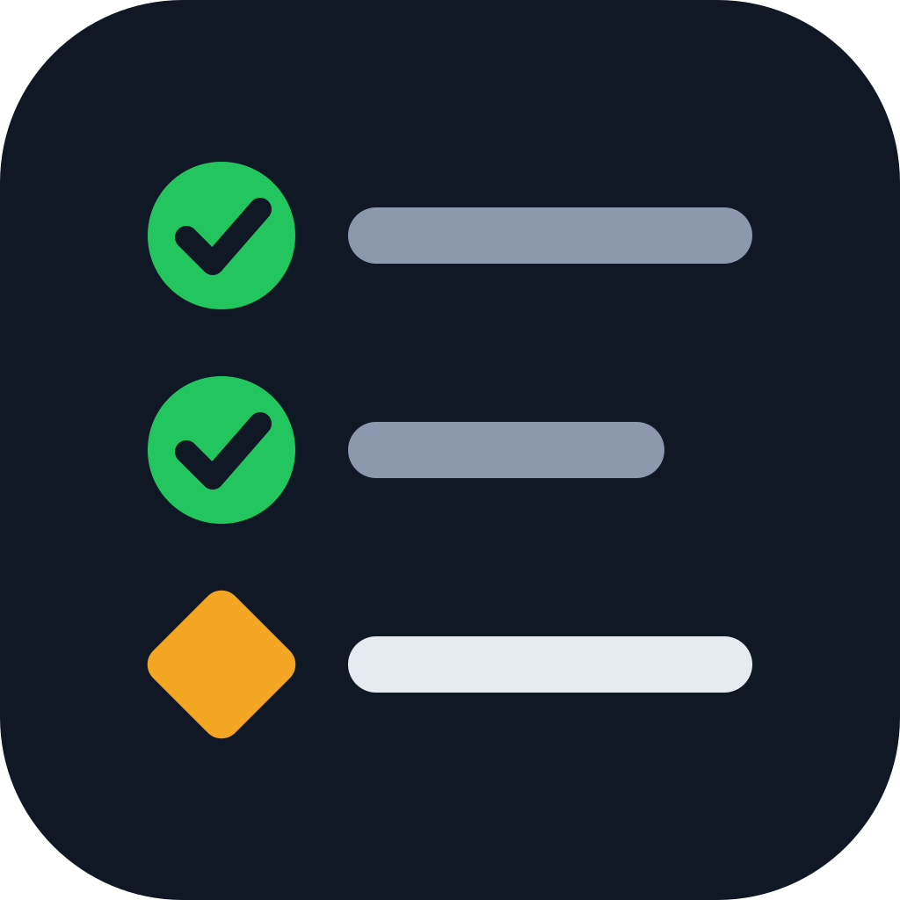
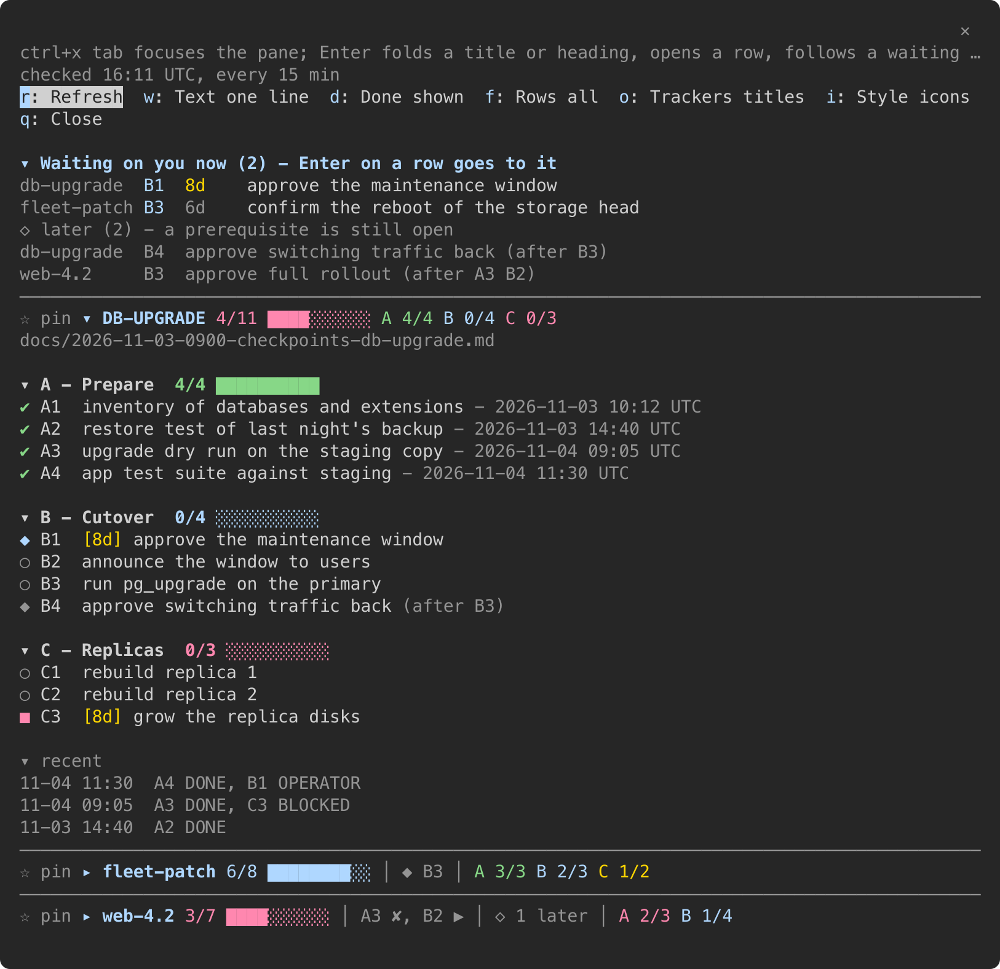

# checkpoints (Claude Code mod)

[](https://github.com/t0d0r/claude-checkpoints/actions/workflows/security.yml)
[](https://github.com/t0d0r/claude-checkpoints/actions/workflows/codeql.yml)
[](LICENSE)

Shows every checkpoint tracker of the current project (`*/YYYY-MM-DD-HHMM-checkpoints-*.md`)
in a pane opened with `/checkpoints` and, optionally, in the status line, merged with the live
lines of the tracker's committed, read-only `progress-check` script (only from
`scripts/checkpoints/` of that project, and only when identical to HEAD). The convention for
trackers and scripts ships with the mod as the skill `skills/checkpoint-tracker/SKILL.md`.

A project without a tracker sees nothing: no cache folder, no status line.



## Install

From the prompt of a terminal session:

```
/plugin install checkpoints --marketplace t0d0r/claude-checkpoints
```

From a shell:

```
claude plugin install checkpoints --marketplace t0d0r/claude-checkpoints
```

Answer `y` to add the marketplace and pick the user scope: the mod then loads in every project.

### One clone for every project

To change the mod yourself, or to control when updates arrive, install it from a clone. The
mod is then read from that folder, not from a copy:

```
git clone https://github.com/t0d0r/claude-checkpoints.git <clone>
claude plugin install checkpoints --marketplace <clone>
```

Update with `git -C <clone> pull --ff-only`, then `/reload-plugins` in sessions that are
already open; new sessions load the new code. Read the incoming diff before the pull: this
code runs in every project.

## Pane

- `/checkpoints` opens and refreshes the pane. `/checkpoints <slug>` pins one tracker to the
  session, `/checkpoints off` unpins.
- It opens as an overview: one title line per tracker with its count, bar, hot rows and
  per-track figures, the pinned one first. A click (or Enter) on a title, a track heading or
  a row opens or folds it; an opened row shows its full text and a link to its line in the
  tracker file.
- "Waiting on you" on top: every OPERATOR row of every tracker. A row whose "depends on" cell
  names an unfinished checkpoint (`B4 + approval`, `C1-C3`) goes under "later" with
  `(after <ids>)`. A click on a row jumps to it.
- Waiting, blocked and failed rows show how long ago the progress log last named them (`4d`,
  `today`, `-`), yellow from 7 days.
- Switches, by click or by key while the pane has the focus:

  | key | switch   | values                                                          |
  |-----|----------|-----------------------------------------------------------------|
  | `r` | Refresh  |                                                                 |
  | `i` | Style    | `icons` (default) / `ascii`; kept for new sessions and the status line |
  | `w` | Text     | one line (default) / wrapped                                    |
  | `d` | Done     | shown (default) / hidden - a track then shows `+ N done: <ids>` |
  | `f` | Rows     | all / you (waiting on you) / hot (blocked, failed, running)     |
  | `o` | Trackers | titles / full                                                   |
  | `p` | Others   | titles / full, with a pin                                       |
  | `q` | close    |                                                                 |

  `/checkpoints icons` and `/checkpoints ascii` set the style too. The icons are plain
  single-width Unicode: no emoji, no patched font.
- Refresh: at session start, every 15 minutes, on `/checkpoints` and on `r`.
- A finished tracker (closed, or every row DONE/OK) hides two days after its last change.
  `/checkpoints <slug>` brings it back.

## Status line (optional)

Each refresh writes one line to `<project>/.claude/checkpoints-cache/status-<session id>.txt`
(0600). `statusline/checkpoints-line.sh` prints it while it is under an hour old; call it from
your own status line script (needs `jq`):

```
input=$(cat)
# ... print your first line ...
ck=$(printf '%s' "$input" | sh <clone>/statusline/checkpoints-line.sh)
[ -n "$ck" ] && printf '%s\n' "$ck"
```

Unpinned: every open tracker as `name done/total` plus only its RUNNING/FAILED/BLOCKED rows
(named when one or two, counted per state when more) and `you: <ids decidable now>
(+N later)` (a count instead of the IDs when more than four); pinned: that tracker with its per-track figures and
the others as `+N open`. Example:

```
ckpt 21:04 UTC | db-upgrade 9/11 you: B1 B2 (+1 later) | web-4 3/8 A3 RUNNING | fleet 27/40 3 BLOCKED, you: 8
```

That is the `ascii` style; `modern` draws the same line with icons and box-drawing separators.
A status line script that cannot show Unicode needs `/checkpoints ascii`.

A tracker is named by the slug after `checkpoints-` in its file name; a header line
`- short-name: <name>` overrides that.

## Progress-check scripts

- A script runs only when its path is under `scripts/checkpoints/` of the project, has no
  `..`, is tracked by git and is identical to HEAD.
- Scripts are shared across sessions: at most one run per 14 min per tracker, under an `mkdir`
  lock in `.claude/checkpoints-cache/`; other sessions reuse the output.
- The mod writes `.claude/checkpoints-cache/.gitignore` (`*`) itself, so the cache stays out of
  git in every project.

## Check after an edit

```
claude plugin validate <clone>
claude plugin test <clone>
tsc -p <clone>
```

`plugin test` mounts the pane in the engine itself (`tests/pane.test.tsx`): a tree the engine
refuses fails there instead of leaving an empty pane. Run it after every change to the
drawing. `tsc` needs the types the engine lays in `.claude-plugin/types/` once it has loaded the mod.

## License

BSD 2-Clause, see `LICENSE`.
